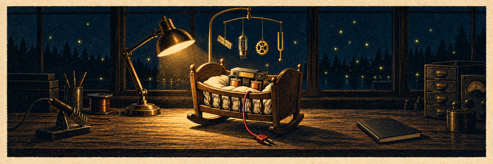

<p align="center">
  
</p>

# Cradle

The code for **"Let's Build a Transformer!"**, a practical article series that builds a transformer inference engine
from an empty program, in C# with ILGPU. Every installment ends with something new that runs; the program grows
until it loads real open weights and generates text.

Named for the "cradle" in Jack Crenshaw's "Let's Build a Compiler!" (1988 to 1995), the starter program his whole
series grew from.

**Status:** the project site and publishing scripts are in place. The runnable baseline and setup prologue are published. The numbered lessons have not been written. Local experiments have validated
C# transformer kernels and a complete small model on Apple Silicon through ILGPU's native Metal backend.

## Repository layout

| Path | Purpose |
| --- | --- |
| `src/Cradle/` | The growing C# console application |
| `tests/Cradle.Tests/` | Numerical correctness tests and small fixtures |
| `articles/` | Authoritative article sources and their images |
| `web/` | Project overview, site templates and shared site assets |
| `docs/assets/` | Repository documentation artwork |
| `scripts/` | Build and article-publishing commands |
| `.github/workflows/` | Build checks and GitHub Pages deployment |

Downloaded weights belong in ignored `models/`; local experiments stay in ignored `experiments/`.

## Run the baseline

Install .NET SDK **10.0.401**, Git, and Python **3.11 or newer**. From the repository root:

```sh
python3 scripts/setup.py
dotnet build Cradle.slnx -c Release --no-restore
dotnet test Cradle.slnx -c Release --no-build --no-restore
dotnet run --project src/Cradle -c Release --no-build --no-restore
```

On Windows, use `python` if that is your installed Python command. Setup fetches and builds the pinned
ILGPU source; first use requires internet access. Expect one passing dependency-load test and
`Cradle is ready.` The baseline does not require a GPU; lesson 1 adds GPU discovery and the first kernel.

The SDK pin is in `global.json`; ILGPU's source revision is in `eng/ILGPU.props`. The setup script uses
reviewed package lock files for both upstream build dependencies and our projects. See
[setup details](scripts/README.md#net-baseline) and the [prologue](articles/00-getting-the-cradle-ready/index.md).

Validated locally on Apple Silicon macOS and in GitHub Actions on Windows, Linux, and macOS. The checks
restore the pinned dependencies, build, test runtime loading, and launch the baseline. Actual GPU correctness
checks are separate. See the [CI runs](https://github.com/plainsight-systems/cradle/actions/workflows/dotnet.yml).

## Preview the site

With Hugo 0.154.2 and Python 3.11 or newer installed:

```sh
python3 scripts/site.py serve --preview
```

Open `http://localhost:1313/`. The article layout specimen is at `/preview/`; it is excluded from production.
The homepage shows the prologue separately, previews the first four lessons and links to the full planned sequence at `/lessons/`, with publication status derived from the articles.
See the [site README](web/README.md) for site structure and content maintenance, and
[build and publishing commands](scripts/README.md) for production builds, GitHub Pages, and article exports.

## Articles and releases

The project site is live at [cradle.plainsight-systems.com](https://cradle.plainsight-systems.com/).
The full articles will appear there and on andrewphunter.com, both from the sources in
`articles/`. Each published lesson will link to its runnable code snapshot.

`main` holds the latest completed, reviewed lesson. Work can stay on local lesson branches; publish `main` and
immutable lesson tags, starting with `lesson-00` for setup and then `lesson-01`. Corrections receive a new tag, leaving the original snapshot intact.

## License

Code, including article code examples, is licensed under Apache 2.0. Documentation, prose, and original visual
assets are licensed under CC BY 4.0, copyright Andrew P Hunter, published by Plainsight Systems LLC.
See [LICENSE](LICENSE) for the split, [LICENSE-CODE](LICENSE-CODE) and [LICENSE-CONTENT](LICENSE-CONTENT) for the
full terms, and [NOTICE](NOTICE) for attribution, third-party licenses, and exclusions.
